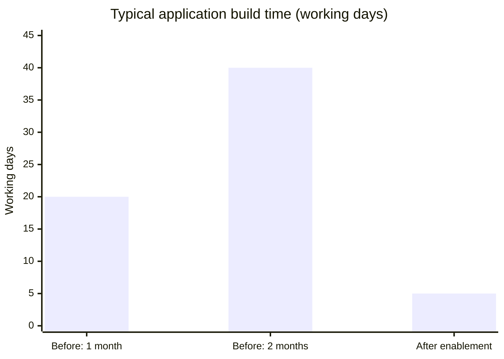
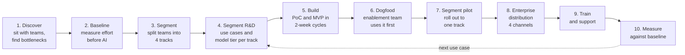

# AI Enablement Case Study: Moving Multi-Domain Teams to an AI-Enabled SDLC

How I took 60+ developers, testers, designers and documentation staff at Gate6 Technologies from traditional delivery to AI-enabled ways of working, and how I reused the same pipeline for organisation-wide enablement at Brand Concepts.

Also published on my site: [AI Lab case study on promptatwork.com](https://promptatwork.com/ai-lab/work/ai-enablement-aidlc-transformation). This repository is the long-form version, with the reusable playbook.

This is a practical execution pipeline, not a framework on paper. Every step below is something I ran, with the owner, the input, the output and the exit check that let us move to the next step. The [playbook](playbook/) folder has the working templates so the pipeline can be run again in another company.

## At a glance

| | |
|---|---|
| **My role** | AI enablement lead and AI solutions engineer, Gate6 Technologies (Feb 2024 – Sep 2026) |
| **People enabled** | 60+ developers, QA engineers, designers and BA/PM/documentation staff at Gate6 |
| **Rollout** | About 6–12 months from the first team to company-wide use |
| **What I built** | 30+ AI PoCs: RAG apps, agents, sub-agent skills, Claude projects and connectors |
| **What the teams built** | Hundreds of agents and multi-agent systems for requirements, development, testing and pipelines |
| **Delivery change** | Typical application build time from 1–2 months to about one working week |
| **Second run** | Brand Concepts: department-wise AI training plus a set of bots for business teams |

*Before enablement a typical application took one to two months (about 20–40 working days). After the teams adopted the AI-enabled SDLC, the same class of application was built in about one working week.*

## The pipeline in one picture

## Read the case study

| # | Section | What it covers |
|---|---|---|
| 1 | [Context and problem](docs/01-context-and-problem.md) | Where the teams started and what was slowing them down |
| 2 | [The execution pipeline](docs/02-execution-pipeline.md) | All ten steps with owner, input, output and exit check |
| 3 | [Segments and model tiers](docs/03-segments-and-model-tiers.md) | The four tracks and why each got a different model approach |
| 4 | [Build, test and release](docs/04-build-test-release.md) | How the enablement team built, dogfooded and hardened every tool |
| 5 | [Enterprise distribution](docs/05-enterprise-distribution.md) | The four channels that put tools in everyone's hands |
| 6 | [Measuring success](docs/06-measuring-success.md) | Baselines, success metrics and the "does this need AI?" test |
| 7 | [Second run: Brand Concepts](docs/07-second-run-brand-concepts.md) | Reusing the pipeline for non-technical departments |
| 8 | [Lessons](docs/08-lessons.md) | What I would keep, and what I learned the hard way |

## Reusable playbook

| Template | Use it in step |
|---|---|
| [Discovery interview](playbook/01-discovery-interview.md) | 1. Discover |
| [Baseline sheet](playbook/02-baseline-sheet.md) | 2. Baseline |
| [Segment R&D canvas](playbook/03-segment-rnd-canvas.md) | 4. Segment R&D |
| [Does this need AI?](playbook/04-does-this-need-ai.md) | 4 and 5 |
| [PoC release checklist](playbook/05-poc-release-checklist.md) | 5 to 7 |
| [Rollout plan](playbook/06-rollout-plan.md) | 7 to 9 |

---

Part of Niharika Dhande's portfolio · [promptatwork.com](https://promptatwork.com) · [LinkedIn](https://www.linkedin.com/in/niharikasaxenadhande) · [GitHub](https://github.com/niharika-dhande)
