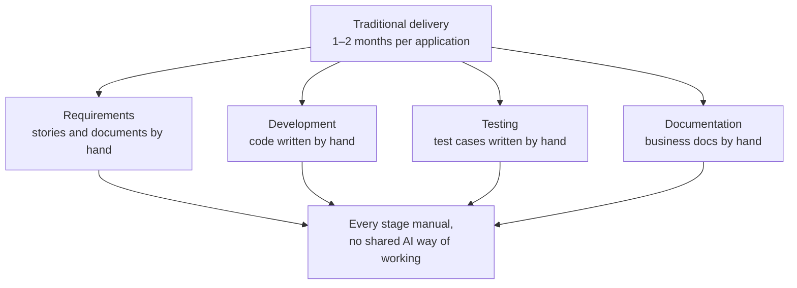

# 1. Context and problem

## Where the teams started

Gate6 Technologies is a software services company in Indore. When I started the AI enablement work in 2024, delivery ran the traditional way: requirements, design, development, testing and documentation moved from person to person, mostly by hand. A typical application took one to two months to build.

The people I had to enable did very different work:

- **Developers** writing full-stack application code
- **QA engineers** writing and running test cases
- **UI/UX designers** designing screens and flows
- **BA, PM and documentation staff** writing requirements, Jira stories, business documents and release notes

## The problem

"Give everyone an AI tool" would not have worked. A developer, a tester and a business analyst lose time in different places, need different levels of model capability, and carry different security risk. One generic rollout would have been too much for some people, too little for others, and impossible to measure.

So before choosing any tool, I worked inside the teams as one of them to understand their issues and the bottlenecks they felt.

## The goal

Move every role to an AI-enabled way of working that:

1. fits the role, not a single tool for everyone
2. is safe for client code and data
3. is built, tested and supported by an enablement team, not left to each person
4. can be measured against how the team worked before

[Next: the execution pipeline →](02-execution-pipeline.md)
