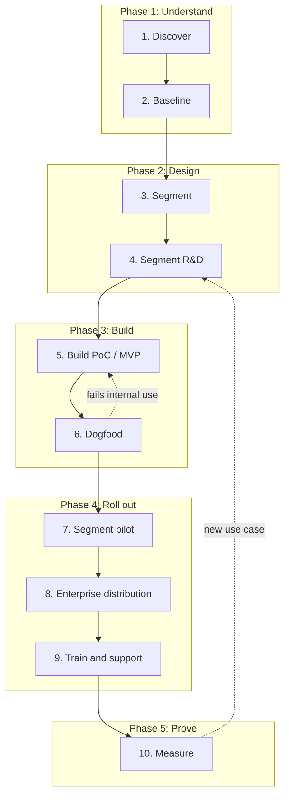
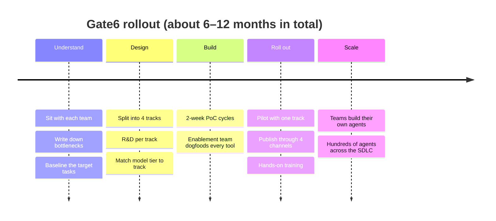

# 2. The execution pipeline

Ten steps, run in order for the first segment and then repeated as a loop for every new use case. Each step has an owner, an input, an output and an exit check. A step is not finished until its exit check passes.

## Step by step

| # | Step | Owner | Input | Output | Exit check |
|---|---|---|---|---|---|
| 1 | **Discover** | Me | Time with each team, as part of the team | List of bottlenecks per role | Every role has its top time-wasters written down |
| 2 | **Baseline** | Me with the team | Bottleneck list | Hours, accuracy and cost per task today | Each target task has a "before" number |
| 3 | **Segment** | Me | Roles, work types, security needs | Four tracks: Developers, QA, UI/UX, BA/PM/docs | Every person belongs to exactly one track |
| 4 | **Segment R&D** | Me with the enablement team | One track's bottlenecks | Use cases, model tier, tool shape for that track | Each use case passes the [does this need AI?](../playbook/04-does-this-need-ai.md) test |
| 5 | **Build PoC / MVP** | Enablement team (developers and testers) | Chosen use case | Working RAG app, agent, skill, Claude project or connector | Built and tested inside a 2-week cycle |
| 6 | **Dogfood** | Enablement team | PoC / MVP | The enablement team's own daily use | Works in real work, issues fixed |
| 7 | **Segment pilot** | Me with the track | Dogfooded tool | Tool in use by one track | Track uses it on live work |
| 8 | **Enterprise distribution** | Me | Piloted tool | Tool published through the right channel | Anyone in the track can reach it without help |
| 9 | **Train and support** | Me | Published tool | Hands-on sessions, support during adoption | People use it without asking how |
| 10 | **Measure** | Me with the team | Usage and task data | "After" numbers against the baseline | Clear keep, improve or retire decision |

## How the phases ran over time

The first track went through every step. Later tracks reused what already existed, so they moved faster. From the first team to company-wide use took about 6–12 months.

## Why this order works

- **Discover before segmenting.** The tracks came from where time was actually lost, not from the org chart.
- **Baseline before building.** Without a "before" number there is no way to prove anything after.
- **Dogfood before pilot.** The enablement team always used a tool on its own work first, so other teams never received a tool that had only been demoed.
- **Pilot one track before distributing.** Problems showed up with one group, not the whole company.
- **The loop.** Once a track was enabled, new use cases from that track went straight back into segment R&D. By the end the teams were building their own agents.

[← Context](01-context-and-problem.md) · [Next: segments and model tiers →](03-segments-and-model-tiers.md)
