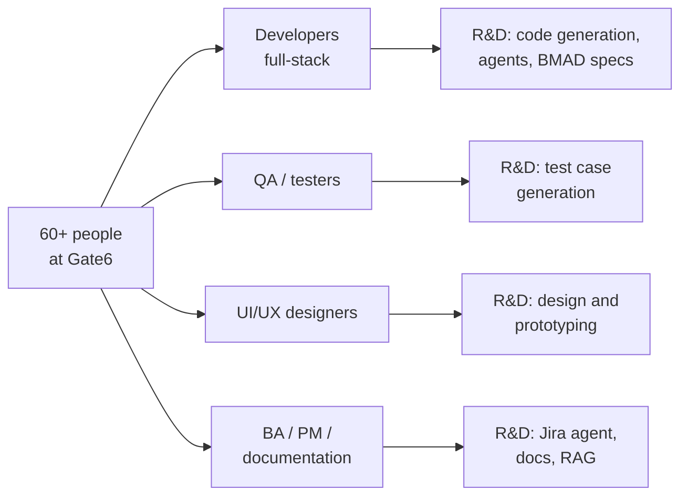
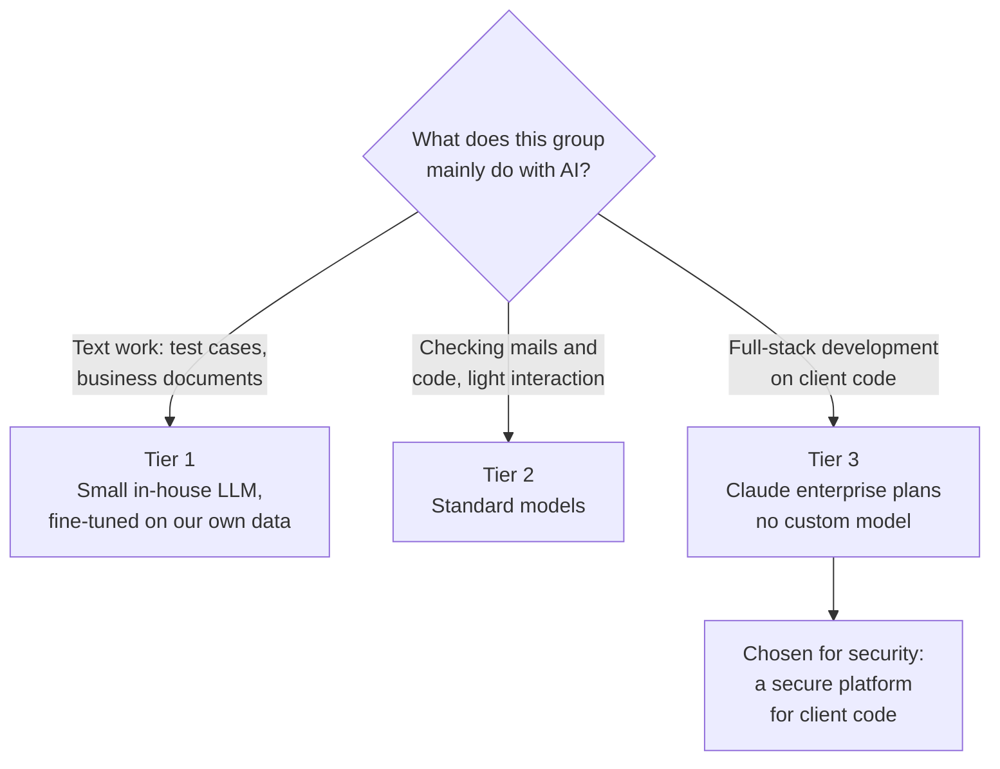

# 3. Segments and model tiers

## The four tracks

I split the teams into four tracks and ran separate R&D for each. Each track got its own use cases, its own tools and its own model approach.

| Track | Focus of the R&D | What it produced |
|---|---|---|
| **Developers (full-stack)** | AI-assisted development on client code | Claude Code workflows, spec-driven development with BMAD, reusable agent patterns, prompt libraries, sub-agent skills |
| **QA / testers** | Test case writing and testing work | Test case generation and testing support |
| **UI/UX designers** | Design work | AI-assisted design and prototyping workflows |
| **BA / PM / documentation** | Stories, business documents and release scope | A Jira agent that pulls stories and boards for a release, document generation, RAG apps over project knowledge |

## Matching the model to the work

Not every role needs the most capable model, and not every role should touch client code. I matched the model approach to the kind of work, which kept cost down and kept sensitive code on a secure platform.

**Why no custom model for developers.** Developers needed the strongest reasoning and a secure, enterprise-grade platform for client code. Building a model for them would have been slower and less safe than Claude on enterprise plans, which also became the shared ecosystem for development and documentation across the company.

**Why a small model for text work.** Test case writing and business documents are mainly text work and don't need the largest model. A small model tuned on our own data handled it, so not every request went to a large model.

## Claude as the shared ecosystem

Claude became the one place where developers and documentation staff worked. Every tool the enablement team built (agents, skills, RAG apps, utilities) was eventually attached to Claude as a connector, plugin, skill or project, so people did not have to learn a new tool for every use case. See [enterprise distribution](05-enterprise-distribution.md).

[← The pipeline](02-execution-pipeline.md) · [Next: build, test and release →](04-build-test-release.md)
