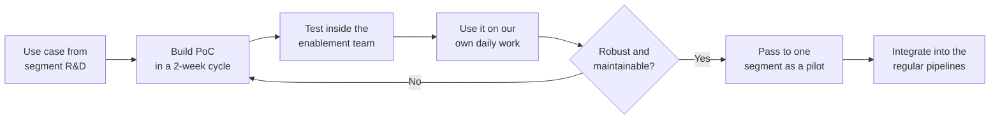
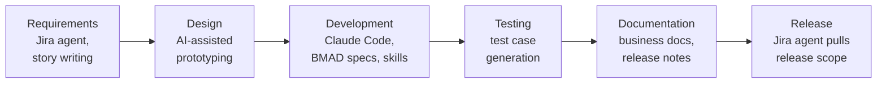
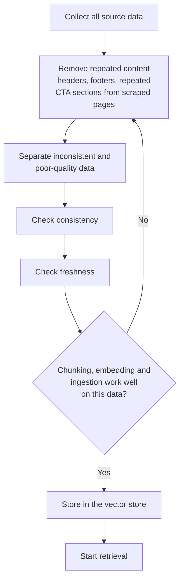
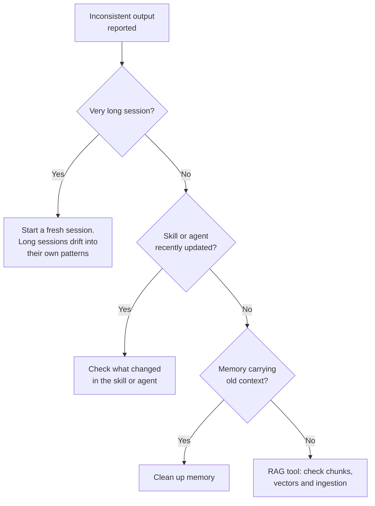

# 4. Build, test and release

## The enablement team

I set up a small enablement team of developers and testers. Testers were part of the team from day one, not added at the end. Together we built every PoC and MVP, tested it, and used it ourselves before any other team saw it.

I personally designed and delivered 30+ of these PoCs, running 2-week delivery cycles: sprint planning, backlog refinement, demos and retrospectives.

## From idea to a tool other engineers can maintain

The rule was simple: a tool left the enablement team only when another engineer could safely take it over and maintain it, and when it could plug into the team's regular pipeline.

## What we built

| Kind of tool | Example |
|---|---|
| **Agent** | A Jira agent that pulls all stories and boards needed for a release |
| **RAG app** | Question answering over project documents and knowledge |
| **Sub-agent skills** | Reusable skills for SDLC and documentation tasks |
| **Claude projects** | Team projects with shared instructions and knowledge |
| **Connectors and plugins** | Our tools exposed inside Claude |
| **Prompt libraries** | Reusable prompts and agent patterns |

## Where AI sits in the SDLC

## Data quality for RAG tools

Every RAG tool went through the same cleaning pipeline before anything reached the vector store. Most bad answers in RAG come from bad data, not from the model.

## When AI output turns inconsistent

Once tools were in daily use, the most common complaint was "it gave me something different this time". I debugged it in this order:

[← Segments and model tiers](03-segments-and-model-tiers.md) · [Next: enterprise distribution →](05-enterprise-distribution.md)
