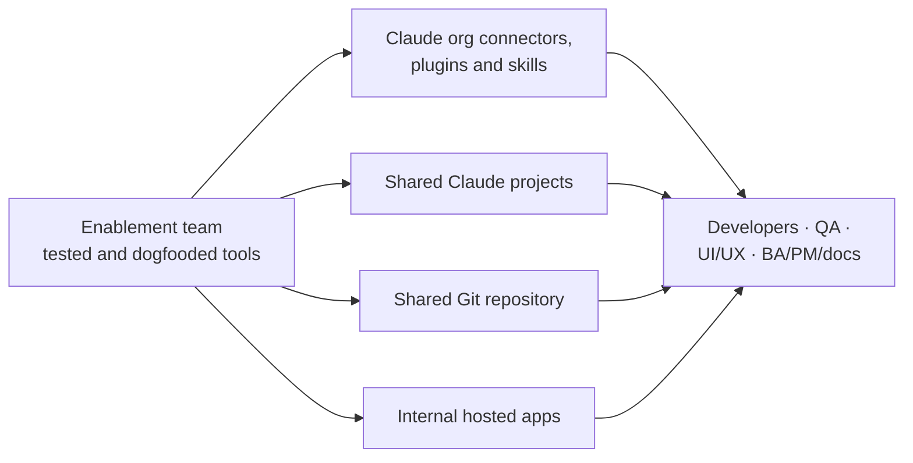
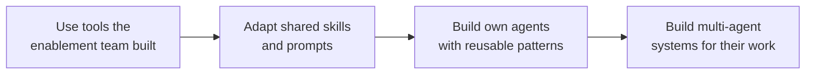

# 5. Enterprise distribution

A tool that only its builder can run is not enablement. Once a tool passed its segment pilot, I moved it to company level through four channels, picking the channel by what the tool was and who needed it.

| Channel | What goes through it | Why this channel |
|---|---|---|
| **Claude org connectors, plugins and skills** | Agents and tools such as the Jira agent | People use them inside Claude, where they already work, with no new tool to learn |
| **Shared Claude projects** | Team instructions, standards and shared knowledge | Everyone on a track starts with the same context and conventions |
| **Shared Git repository** | Agents, skills, prompt libraries and reusable agent patterns | Versioned, reviewed and maintainable by any engineer |
| **Internal hosted apps** | RAG apps and bots | Usable by people who don't work in Claude or Git every day |

## What made it enterprise level

- **One ecosystem.** Claude on enterprise plans was the main environment for development and documentation, so tools reached people where they already worked.
- **Security first.** Developers worked on Claude enterprise plans, chosen because they needed a secure platform.
- **Versioned and owned.** Every shared agent, skill and prompt library lived in Git, so any engineer could maintain it, not only the person who built it.
- **Reachable by non-coders.** Hosted apps meant designers and documentation staff got the same tools without needing developer setups.

## From consumers to builders

The distribution channels did more than hand out tools. Once people had working examples in a shared repository and inside Claude, they started building their own. By the end, the teams had built hundreds of agents and multi-agent systems for requirements, code generation, testing and pipeline work.

[← Build, test and release](04-build-test-release.md) · [Next: measuring success →](06-measuring-success.md)
