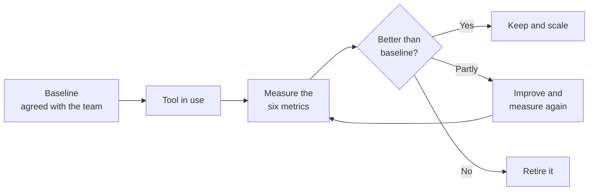
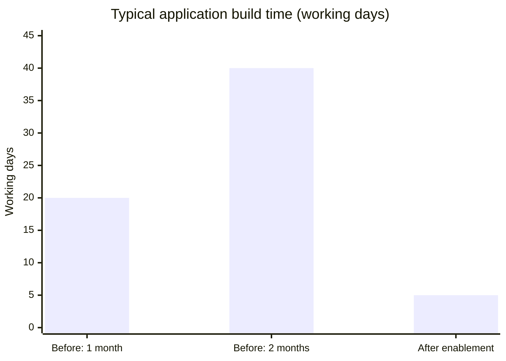
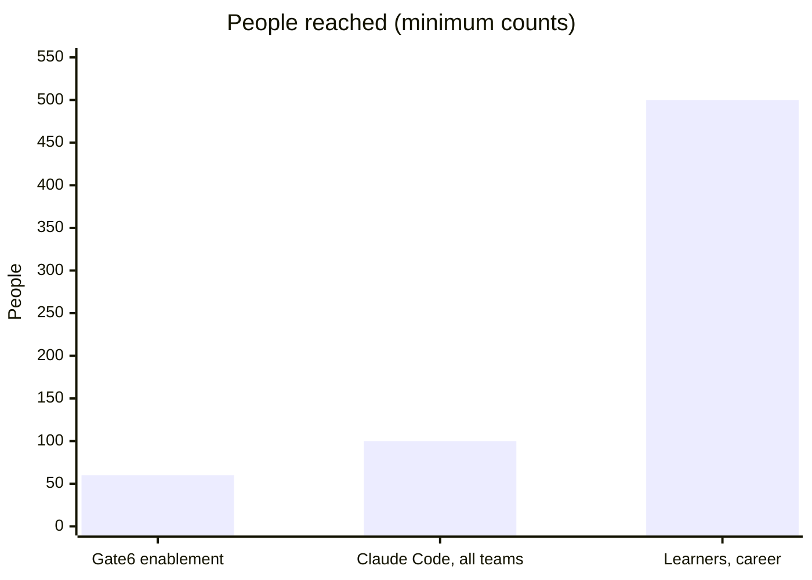
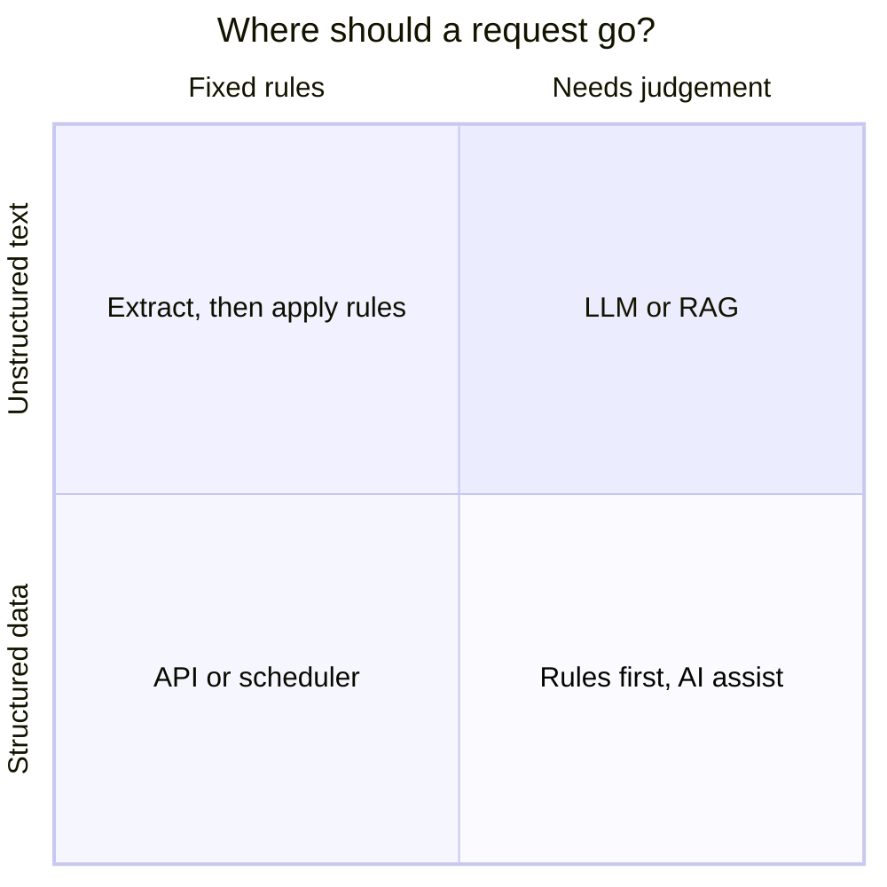

# 6. Measuring success

## Baseline first

Before building anything for a team, I agreed a baseline with them: how the task is done today and what it costs. For example, if people spend several hours a day answering repeated questions, that time is the baseline the tool has to beat.

## The success metrics

| Metric | Question it answers |
|---|---|
| **Manual effort reduced** | How much hands-on work did the tool remove? |
| **Accuracy and reliability** | Are the outputs correct, and correct every time? |
| **Time saved per task** | How much faster is the task end to end? |
| **Cost** | What does the tool cost to run compared with the time it saves? |
| **Adoption and satisfaction** | Are people actually using it, and do they want to? |
| **Security and compliance** | Does it meet the company's and the client's requirements? |

## The headline result

*One to two months is shown as 20–40 working days. After enablement, a typical application took about one working week.*

## Reach

*All three are minimums: 60+ people at Gate6, 100+ people enabled with Claude Code across Gate6, Brand Concepts and other teams, and 500+ learners trained across my career.*

## Does this even need AI?

Part of enablement is saying no. Before any use case went into a build cycle, it passed this test:

- **Predictable, rule-based work** goes to traditional automation: APIs, schedulers and scripts.
- **Unstructured documents, natural-language questions, summaries and retrieval** go to an LLM or RAG solution.
- If a simple workflow or API integration solves the problem reliably, I recommend that instead. An AI agent adds complexity, cost and unpredictability. My job is business outcomes, not adding AI where it isn't needed.

The working version of this test is in the playbook: [does this need AI?](../playbook/04-does-this-need-ai.md)

[← Enterprise distribution](05-enterprise-distribution.md) · [Next: second run at Brand Concepts →](07-second-run-brand-concepts.md)
