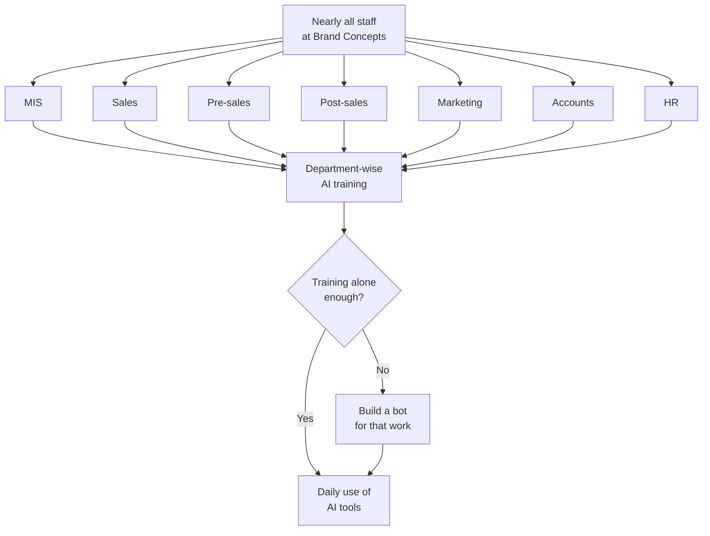

# 7. Second run: Brand Concepts

## A different audience

The second time I ran this pipeline was for organisation-wide AI enablement at Brand Concepts, a consumer brand. This time the audience was almost entirely non-technical: nearly all staff across MIS, sales, pre-sales, post-sales, marketing, accounts and HR.

## What carried over and what changed

The structure stayed the same: discover, segment, match the approach to the work, enable, support. What changed was the balance. Business teams needed department-wise training first, with a smaller set of bots built for the work where training alone wasn't enough.

| Pipeline step | Gate6 (technical teams) | Brand Concepts (business teams) |
|---|---|---|
| Segment | 4 SDLC tracks | 7 departments |
| Segment R&D | Use cases per SDLC track | Use cases per department |
| Main delivery | Tools built by the enablement team | Department-wise hands-on training |
| Bots | Hundreds of agents across the SDLC | Some bots for business teams |
| Distribution | 4 channels, Claude-centred | Training plus the bots built for teams |

## Why the same pipeline still worked

The steps don't depend on the audience being technical. Segmenting by the work people actually do, running R&D per segment, and checking whether a use case needs AI at all worked the same way for an accounts team as for a QA team. Only the output of each step changed.

[← Measuring success](06-measuring-success.md) · [Next: lessons →](08-lessons.md)
