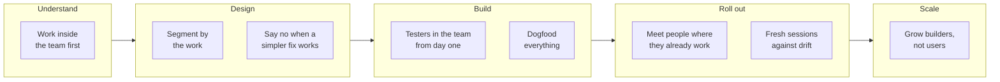

# 8. Lessons

*Each lesson sits at the pipeline phase where it matters most.*

**Work inside the team before designing anything.** I found the real bottlenecks only by working as part of each team. The four tracks came from that, not from the org chart.

**Segment by the work, not by seniority.** A tester and a developer at the same level need completely different tools and models. Matching the model tier to the type of work kept cost down and kept client code on a secure platform.

**Put testers in the enablement team from day one.** With testers building alongside developers, every tool was tested before it left the team, and other engineers could safely take it over and maintain it.

**Dogfood everything.** No tool reached another team until the enablement team had used it on its own work first.

**Meet people where they already work.** Attaching tools to Claude as connectors, skills and projects meant people didn't have to learn a new tool for every use case.

**Long sessions drift.** A very long working session builds up its own patterns and starts giving different results, especially for document design. A fresh session, a check of recent skill or agent updates, and a memory clean-up fixed most "inconsistent output" reports.

**Saying no is part of the job.** Some requests are better served by an API or a scheduler. My responsibility is business outcomes, not adding AI where a simpler integration works.

**The goal is builders, not users.** The real result was not the 30+ PoCs I delivered. It was teams going on to build hundreds of their own agents.

[← Second run: Brand Concepts](07-second-run-brand-concepts.md) · [Back to the overview](../README.md)
