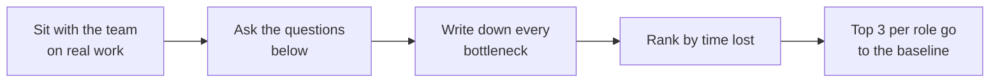

# Discovery interview

**Pipeline step:** 1. Discover · **Owner:** enablement lead · **Time:** one session per role, then a few days working inside the team

Work inside the team as one of them. Don't open with tools; open with the work.

## Questions per role

1. Walk me through yesterday. Which tasks took the longest?
2. Which tasks do you repeat every week in almost the same way?
3. Where do you wait on someone else before you can continue?
4. What do you write that someone else then rewrites?
5. Which documents, boards or systems do you search most often?
6. What data or code are you not allowed to share outside the company?
7. Which AI tools do you already use, officially or not?

## Output

| Role | Bottleneck | Hours lost per week (estimate) | Repeats weekly? | Sensitive data involved? |
|---|---|---|---|---|
| | | | | |

**Exit check:** every role has its top three time-wasters written down and ranked.
