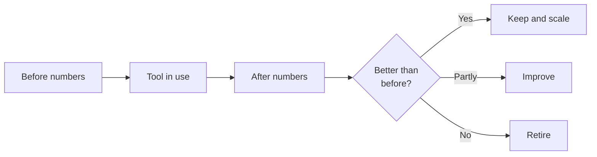

# Baseline sheet

**Pipeline step:** 2. Baseline · **Owner:** enablement lead with the team

Agree the "before" numbers with the team before building anything. Without them there's nothing to prove later.

| Task | Track | Who does it | Time per task today | Times per week | Accuracy or rework today | Cost or tool spend today |
|---|---|---|---|---|---|---|
| | | | | | | |

## After the tool is in use

| Task | Time per task after | Manual effort removed | Accuracy after | Adoption (people using it weekly) | Security and compliance OK? | Decision |
|---|---|---|---|---|---|---|
| | | | | | | Keep / improve / retire |

