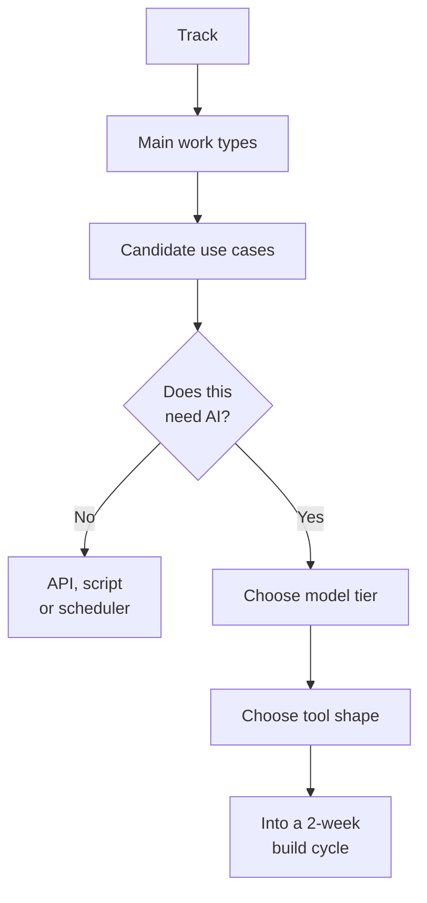

# Segment R&D canvas

**Pipeline step:** 4. Segment R&D · **Owner:** enablement lead with the enablement team

Fill one canvas per track (for example Developers, QA, UI/UX, BA/PM/documentation, or one per department for business teams).

## Canvas

**Track:**

**People in this track:**

**Main work types:** (text-heavy, code, design, mixed)

**Top bottlenecks from discovery:**

| Candidate use case | Baseline task it improves | Needs AI? (see test) | Model tier | Tool shape | Priority |
|---|---|---|---|---|---|
| | | | | | |

**Model tier options**

| Tier | Fits | Example |
|---|---|---|
| Small in-house model | Text work in the company's own formats | Test cases, business documents |
| Standard model | Light interaction | Reading and drafting mails, quick code checks |
| Enterprise frontier model | Complex reasoning on sensitive code or data | Full-stack development on client code |

**Tool shape options:** agent · RAG app · skill or sub-agent skill · shared project · connector or plugin · prompt library · hosted bot

**Security notes for this track:**
