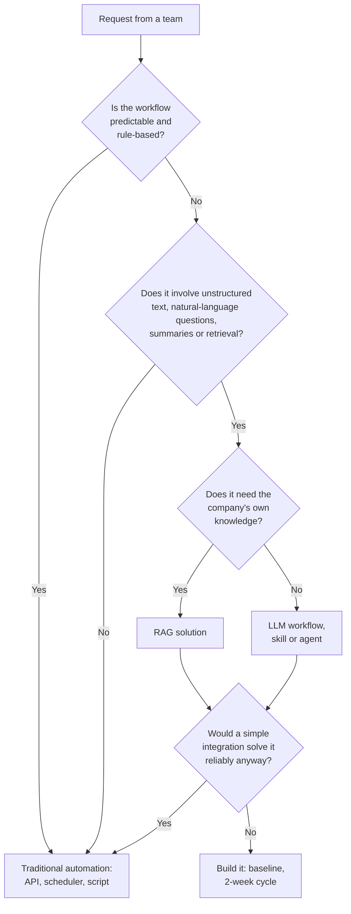

# Does this need AI?

**Pipeline step:** 4 and 5 · Use before any use case enters a build cycle.

## Checklist

- [ ] The task is not fully predictable with fixed rules
- [ ] It involves unstructured text, language understanding, summarisation or retrieval
- [ ] A simple workflow or API integration would not solve it reliably
- [ ] There is a baseline to beat (time, effort, accuracy or cost)
- [ ] The data it touches can be used on the chosen platform
- [ ] Someone on the team will own and maintain it after rollout

If any of the first three boxes is unticked, recommend the simpler option. AI adds complexity, cost and unpredictability, so it has to earn its place.
