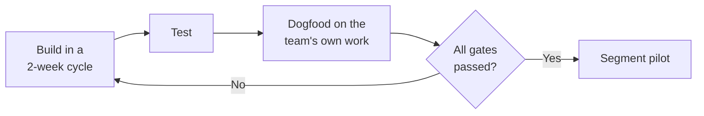

# PoC release checklist

**Pipeline steps:** 5. Build → 6. Dogfood → 7. Segment pilot · **Owner:** enablement team (developers and testers)

## Gate 1: built

- [ ] Code, prompts, skills and workflow definitions are in version control
- [ ] Environment settings (keys, model settings, endpoints) are kept separate from code
- [ ] A short README explains what it does, who it's for and how to run it

## Gate 2: tested

- [ ] Normal requests from the target track
- [ ] Unexpected and incomplete inputs
- [ ] Integrations (Jira, Git, documents, APIs) and their error handling
- [ ] Output quality and consistency across repeated runs
- [ ] Response time is acceptable for daily use
- [ ] For RAG: data cleaned (repeated content removed, poor-quality data separated, consistency and freshness checked) before ingestion

## Gate 3: dogfooded

- [ ] The enablement team used it on real work, not only demos
- [ ] Issues found in that use are fixed
- [ ] Another engineer, not the builder, can maintain it

## Gate 4: ready for the pilot

- [ ] Baseline numbers exist for the task it improves
- [ ] The distribution channel is chosen (connector, shared project, Git repo or hosted app)
- [ ] A short hands-on session is planned for the pilot track
