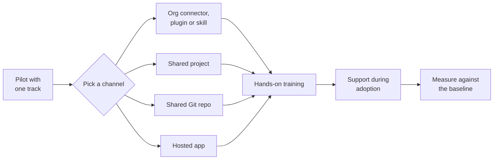

# Rollout plan

**Pipeline steps:** 7. Segment pilot → 8. Enterprise distribution → 9. Train and support → 10. Measure

## Choosing the channel

| If the tool is… | Publish it as… |
|---|---|
| An agent or tool people use inside their AI workspace | Org connector, plugin or skill |
| Shared instructions, standards or team knowledge | Shared project |
| Code, skills, prompt libraries or agent patterns | Shared Git repository |
| A bot or RAG app for people who don't use the AI workspace or Git | Internal hosted app |

## Rollout table

| Tool | Pilot track | Channel | Training date | Support owner | Measure on |
|---|---|---|---|---|---|
| | | | | | |

## Training format

- Show the tool on the track's own real work, not a generic demo
- Everyone runs it themselves during the session
- Leave a one-page guide and a place to ask questions
- Check in after the first week of real use

## When a track is fully enabled

New use cases from that track go straight back into the [segment R&D canvas](03-segment-rnd-canvas.md). The aim is for each track to start building its own agents with the shared patterns.
